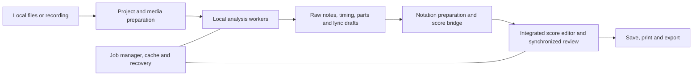

# SMPL Tones development plan

**Status: planned application. This repository release contains documentation, evidence metadata and validation tooling only. No app, native model conversion, trained weights or installer is implemented here.**

## Summary and fixed decisions

Build one self-contained Windows 11 x64 desktop application with a full score editor, local transcription and an offline installer. The project is public and the application direction is GPL-3.0-only. Required model terms must permit commercial use, with their attribution/redistribution obligations preserved. A separate installed music application, Python environment, account or first-use download is not an acceptable runtime dependency.

Start from stable MuseScore **v4.7.6**, commit `96480d58445e3b24b230a3fe7d4725d639aa2eb3`, to retain mature editing, engraving, parts, undo, accessibility, playback and symbolic import/export. Build a separately branded application with integrated transcription/review modules. Do not base production work on the earlier unstable 5.0 `main` snapshot. Preserve upstream notices and keep application-specific changes in bounded modules where practical.

The default recognition candidate is author-published YourMT3+ **YPTF+Multi (PS)**. Its exact model/source pins are in [planning provenance](evidence/planning-sources.json). This is a deliberate change from the earlier MuScriptor recommendation: MuScriptor/Sheet Sage weights are excluded from the required bundle by the final model policy. Original Magenta MT3's separately hosted checkpoint licensing remains a different unresolved question.

Native export and performance of the selected model are **not established**. Prove them before building dependent product functionality. A failure must produce a documented blocker, not an unannounced cloud dependency, external-app requirement or incompatible model substitution.

## Product scope

### Inputs and project workflow

- Import local WAV, MP3, FLAC, AIFF, OGG and supported local video/audio containers through bundled decoding. Support MIDI, MusicXML/MXL and native-score input through the integrated editor.
- Record microphone, WASAPI system audio and MIDI with device/rate selection, visible levels and explicit start/stop. Recording stores a local source asset for later analysis; real-time transcription is not an initial latency promise.
- Support complete songs, selected ranges, instrument selections and batch queues. Long media is segmented rather than rejected merely because a hosted service would impose a duration/upload limit.
- Save a project with original media, editable score, raw analysis, alignments, settings and engine/model provenance. Offer independent source/performance and written-score exports.

### Recognition, musical analysis and correction

- Recognize full-mix note events, pitched parts, vocal notes and percussion with the declared vocabulary of the selected engine; keep unknown assignments editable.
- Offer direct-mix processing first and optional separated-source alternatives. Provide stem audition, selective retranscription and a comparison view.
- Detect audio beats/downbeats, build tempo maps and expose first-downbeat, BPM, meter, pickup, subdivision and quantization controls. Treat ambiguous meter as provisional rather than silently asserting a detected 4/4.
- Support swing/triplets, ties/rests, hand/voice splitting, drum maps, chord/key suggestions, melody selection, lead sheets and non-destructive simplified arrangements.
- Provide a lyric-draft pass on a vocal source, editable text and manual syllable-to-note alignment. Singing recognition and syllable placement are separate problems; do not claim speech-model timestamps already solve both.
- Retain full notation editing, part extraction, layout, tuning/capo and fretted tablature. Automatic fingering/voice choices remain inspectable and correctable.

### Playback and exports

Synchronize original/stem audio, waveform, piano roll, score cursor and selection. Include local soundfont playback, mute/solo, per-part levels, loops and slower review playback. The source/performance clock and score-beat clock must remain explicitly mapped.

Export native projects/scores, MusicXML, full-score/part PDFs, synthesized audio, performance MIDI, quantized MIDI, GP5 and LilyPond text. Use inherited mature writers where present. Add native GP5 and LilyPond writers; the inspected stable MuseScore Guitar Pro module only registers import readers. Unsupported target-format constructs must produce an export report rather than disappear silently.

Performance MIDI uses current note content with retained performance timing where still applicable; newly created or deliberately retimed notes derive timing from the edited beat map. Quantized MIDI represents written timing. Preserve the original input as a distinct immutable reference.

Excluded from the initial product: cloud transcription, social-link fetching, online collaboration, Android, VST3 product delivery, model training, every historical vendor format and every research framework/model variant. Those exclusions do not remove the complete modern music workflow above.

## Component and deployment architecture

| Component | Fixed initial direction | Gate before integration/release |
|---|---|---|
| Editor/engraver | Native C++17/Qt codebase from stable MuseScore 4.7.6 | Rebranded build; retained import/edit/print behavior; no required online modules. |
| Full-mix recognition | YourMT3+ YPTF+Multi (PS), author checkpoint/source pins | License/asset ledger, native export and event parity, CPU/GPU memory and speed. |
| Isolated-instrument recognition | Official Basic Pitch ONNX model and native postprocessor | Exact frontend/windowing/bend-decoding parity and model/runtime notices. |
| Beat tracking | Beat This final0; small variant for fast drafts | Exact frontend and postprocessing parity; CPU/native model conversion validation. |
| Separation | Demucs-based bounded native worker, fixed documented stem model | Exact weight terms, conversion parity, overlap reconstruction and backend support. |
| Lyric draft | whisper.cpp with multilingual small model | Artifact/quantization provenance, native Windows build and singing-focused evaluation. |
| Chords/key/reductions | Native chroma/note analysis and editable musical heuristics | Fixed corpus, explicit uncertain/unsupported cases, no generated parts overwriting originals. |
| Media | App-local FFmpeg libraries built with networking disabled | Required local codecs, timestamp/rate correctness, package notices. |
| ONNX runtime | App-local CPU and DirectML providers | No dynamic provider downloads; compatible opset/operators and session settings. |
| Playback | Integrated editor/audio pipeline and bundled General MIDI soundfont | Device handling, source/score alignment, required asset licenses. |
| Installer | One x64 offline MSI | All required runtimes/assets available at first launch without network access. |

Python/PyTorch may be used in the **development conversion environment**, with pinned versions and reproducible scripts. Do not package Python, PyTorch, TensorFlow, JAX, training tooling or a browser merely to run the shipped inference pipeline. No separate MuseScore executable installation is required: its editor implementation becomes part of SMPL Tones.

Use ONNX opset 18 as the initial export target within the documented DirectML support envelope. Reproduce feature extraction exactly and export encoder/decoder stages with cached decoding state; do not translate only the network and omit event/tie assembly. Keep CPU reference artifacts until validated optimizations justify removing them. Operator lowering or quantization requires the same parity gates as other model changes.

DirectML needs validated static/dynamic shapes, sequential session execution and disabled memory-pattern optimization as documented. Enumerate adapters explicitly: laptop adapter zero may be the integrated GPU. GPU use is optional; CPU operation is mandatory. Avoid a dynamic execution-provider catalog requiring downloads. Revisit provider choices only as an explicit architecture decision with an offline acceptance run.

### Process boundaries

The application owns the editor, transport and job manager. Media/inference workers run out of process so a crash or GPU reset does not terminate editing. Use process pipes, with versioned newline-delimited JSON control/progress messages on stdout and diagnostic logs on stderr. Pass large audio/results as local artifact paths or mapped buffers; never encode waveform arrays into control JSON.

Allow one GPU-heavy job stage at a time. Decode/resample through bounded buffers and cache reusable source representations. Maintain a small bounded queue between workers and the UI; apply score changes on the editor thread through its undo API. Stop loading models on the GUI thread.

### Versioned engine contracts

| Contract | Minimum fields/behavior |
|---|---|
| Engine manifest v1 | Engine ID/version, protocol version, capabilities, executable identity, model hashes/license, input/frontend requirements, vocabulary, backend options and resource estimates. |
| Job request v1 | Job/project/revision IDs, input asset hash and local path, time range, task, selected instruments, settings and engine/model identity. |
| Analysis result v1 | Timed note/part/drum events, beat grid and optional chord/lyric results; provenance, warnings, units and nullable genuine confidence. |
| Progress/checkpoint v1 | Stage, completed/total work units, finalized range, durable artifact identities and resume information. |
| Score bridge | Analysis-note identity to editable score elements and source-time/score-beat mapping; grouped undoable changes and alternative-take application. |

Models may differ in sample rates, vocabularies, supported parts and expression. Put those facts in the manifest/adapter. Use seconds for performance time and rational quarter-note positions for score time, not an implicit shared floating-point tick format. Preserve source precision and describe MIDI export resolution explicitly.

No per-note confidence percentage is invented for engines that do not produce calibrated confidence. Review flags can instead identify a specific conflict or ambiguity. Treat unsupported tasks as a capability result, not as a successful empty transcription.

Engine replacement must not require rewriting the editor, cache or project format. Package installation is an explicit settings operation; never execute an engine program embedded in an opened score project. Store only data, references and provenance in projects.

## Project data, caching and recovery

Use a versioned ZIP64-capable SMPL Tones project container containing the native score, original media, analysis metadata and alignments. Media is immutable. Working caches and autosave/journal data live outside the saved archive to avoid rewriting a large recording every few seconds.

The human-edited score is authoritative. Keep raw recognition and subsequent engine takes as distinct versioned artifacts. Attach persistent transcription identities to linked score notes; edits retain the link, copies receive new identities, and deleted elements are not resurrected automatically. Restore those relationships across save/reopen through explicit serialized metadata.

Cache keys include input hash, range, engine/model/front-end/decoder versions and analysis settings. A layout or lyric-text change does not invalidate note recognition. Beat/quantization edits rederive notation from retained events. Stem/recognition/lyric jobs have separate dependencies and checkpoints.

Write autosave/journal state at most ten seconds after committed edits and at finalized job stages. Explicit project save writes a temporary complete archive and atomically replaces the destination, retaining a recoverable previous version. Validate a new artifact before marking a stage complete. Resume from the last finalized stage/chunk after a worker failure or application restart.

Retranscription creates a new take based on the starting project revision. If editing continued during inference, show a comparison and apply selected changes as an undoable operation; never silently replace newer manual edits. Cancellation is cooperative first, then terminates a non-responsive worker while preserving completed checkpoints. Permit one bounded backend retry; repeated failures end visibly with local diagnostics rather than a retry loop.

## Processing modes and resource budgets

- **Fast draft:** direct full-mix pass, smaller beat model, no automatic separation or lyric pass. Isolated-source mode can use Basic Pitch.
- **Balanced default:** direct full-mix recognition, final0 beat tracking, timing/notation preparation and editable chord/key suggestions. No expensive separation unless requested.
- **Detailed:** optional separation and selected-part passes, with alternatives retained for comparison. Lyrics are a separately selected task. More processing is not assumed to improve every song.

Initial reference hardware: i9-13900H, approximately 32 GB RAM, RTX 4060 Laptop GPU with 8 GB dedicated VRAM. Windows 11 x64 and CPU-only operation are mandatory release paths; record the actual tested CPU/RAM baseline before describing minimum requirements publicly.

| Budget | Initial target, not measured |
|---|---|
| Complete compressed installer | At most 1.5 GiB |
| Installed app and required assets | At most 3 GiB |
| Idle RAM | At most 500 MiB |
| Reference workflow working RAM | At most 6 GiB |
| Balanced direct transcription on reference GPU | Approximately real time for representative full songs |
| UI response | Remains responsive during decoding, loading, processing, cancellation and save |

Measure peak GPU allocation separately and leave memory for the OS, editor and display. Reduce inference batches before crossing the configured memory budget. If the selected backend cannot continue, preserve the checkpoint and provide a reported CPU fallback; do not claim unchanged timing or speed. Unload expensive idle models when they are no longer needed.

Do not meet a size budget by omitting required first-run assets. Pin one validated set of model variants and shared runtimes instead of shipping every research stack. If budgets cannot be met, report the measured blocker and update an explicit decision before release; no hidden runtime download is acceptable.

## Twelve implementation milestones

The machine-readable [roadmap](evidence/roadmap.json) and [issue index](ROADMAP.md) give dependencies, deliverables and completion criteria for each step.

1. **Provenance/licensing freeze:** complete exact code/model/asset ledger, frontend configurations, author statements and distribution notices. Preserve source and artifact hashes. Required unverified/restricted assets cannot enter a release.
2. **Native inference feasibility:** implement native YourMT3+ feature processing, encoder/decoder export, cached generation and event/tie reconstruction. Compare CPU/GPU outputs, memory and timing against the pinned author implementation. Block dependent work if feasibility fails.
3. **Desktop foundation:** build and brand the stable editor, remove required online paths, retain accessibility/undo, integrate local project handling, and demonstrate offline MIDI editing/playback/PDF/MusicXML.
4. **Media/jobs:** add local import/recording, waveform caches, bounded processing, worker isolation, progress, cancellation, queueing and durable stage recovery.
5. **Replaceable engines:** implement manifest/request/result contracts, native YourMT3+/Basic Pitch adapters, range and instrument controls, preview and capability handling.
6. **Timing/notation:** integrate Beat This, tempo maps, provisional/corrected meter, quantization, rests/ties/tuplets, voices, hand splitting and percussion mapping without destroying performance timing.
7. **Correction workflow:** synchronize audio/waveform/piano roll/score, implement note split/join/reassignment, looping, alternatives and non-destructive apply/undo.
8. **Separation/detailed mode:** validate native Demucs processing, stem caches/playback and selected-part retranscription. Compare takes instead of blindly merging duplicate/conflicting events.
9. **Vocals/lyrics/reductions:** integrate local lyric drafts, manual syllable alignment, vocal review, chord/key suggestions, lead sheets, simplification and playable tablature/tuning/capo controls.
10. **Exports:** finish performance/quantized MIDI, native project/score, MusicXML, full-score/parts PDF and audio; implement GP5/LilyPond writers with explicit loss reports and reader round trips.
11. **Optimization/hardening:** profile reference CPU/GPU workflows, validate any quantization, bound caches/memory, test failure recovery and reduce runtime duplication. Publish measurements instead of inferred speed claims.
12. **Installer/release:** package all assets/runtimes, validate first launch and workflows on a clean offline Windows machine, complete source/build instructions, checksums, notices, source-availability obligations and release documentation.

Implementation changes should remain small and independently reviewable. Use focused checks for changed behavior. Full builds, installer scenarios and broader compatibility validation belong in explicit release CI rather than every small local edit.

## Verification and release criteria

### Numerical and transcription checks

Use fixed synthetic and rights-cleared real fixtures covering solo instruments, mixed bands, vocals, percussion, sustained/chunk-crossing notes, rubato, swing, reverb and meter changes. Preserve a validation/holdout distinction when tuning settings. Record model vocabulary, note-onset/offset and instrument/drum metrics rather than collapsing everything into one accuracy claim.

Compare native inference against the pinned upstream reference using identical input/frontend/decode settings. Include EOS behavior, tie continuity, segment ordering, source offsets, padding, resampling and short clips. An optimized runtime must not lose more than **0.5 percentage points** on the fixed transcription metric relative to its reference. This is a conversion/regression gate, not a promise of absolute accuracy on arbitrary songs.

A feature/neural-output comparison alone is insufficient: also compare final note events and part assignments. Preserve known reference deficiencies rather than quietly attributing them to a different stage. Calibrate or label uncertainty rather than generating unsupported precision percentages.

### Musical correctness and round trips

- Imported MIDI retains source tempo/expression information where supported; notation interpretation is inspectable.
- Every generated measure has a valid duration or explicit pickup; ties, tuplets, voices, drum maps, hands and part identities are coherent.
- Timing corrections update the score/audio mapping without forcing recognition or discarding raw performance data.
- Save/reopen retains edits, alignments, provenance and alternatives. Manual edits survive a failed job and a later accepted/rejected transcription take.
- MusicXML/MIDI/GP5 export/import fixtures preserve supported content. Unsupported constructs generate a concrete report.
- PDFs and parts are visually checked for the affected notation/layout cases. LilyPond text is validated against its documented supported subset in release tooling.

### Failure and offline checks

Exercise silence, truncated/corrupt media, unknown formats, very long files, Unicode filenames, absent recording devices, GPU reset/OOM, full disk, interrupted save, worker crash, missing/corrupt assets, cancellation and older project versions. A failed inference stage must not corrupt the editable score or delete the source recording.

Install and first-launch on a clean Windows machine with networking disabled. Open/import, record, transcribe, edit, play and export without an account, another music app, Python or model/provider downloads. Verify the complete required asset manifest, checksums and license notices. Check app-owned processes for required DNS/HTTP/external-AI traffic; OS activity outside those processes is not evidence of an app request.

Release validation records actual installer/disk/idle/peak memory, GPU use, cold/warm loading, per-stage times and end-to-end time. Test adapter selection on a dual-GPU laptop and CPU fallback. Publish the benchmark conditions and correction-time observations before describing the product as faster, more accurate or lighter than alternatives.

### Packaging and publication

Create a single offline x64 MSI with embedded media and app-local required runtimes. No web bootstrapper or download custom action may satisfy a required component. Model files and notices are packaged assets with locked hashes; they do not belong as large binary blobs in the documentation/source repository.

Developer packages may be unsigned. Stable public installer publication requires the project's release-signing input and verified source/checksum/notice artifacts; absence of a certificate does not prevent local development builds. Updates are manual/offline packages initially. No telemetry or automatic update traffic is required.

## Assumptions and unresolved engineering facts

The product choices above are fixed by the accepted specification. The project still needs numerical/runtime feasibility results, exact integrated asset-license review, end-user hardware measurements and actual model-conversion/build work. Those are milestones with observable pass/fail outputs, not completed capabilities.

The dossier preserved today is sufficient to understand the investigations without the original local REA folders, but re-running binary analysis requires original inputs. No automated deletion of those folders is authorized. No automatic cloning/building of the future application is part of this documentation publication.
